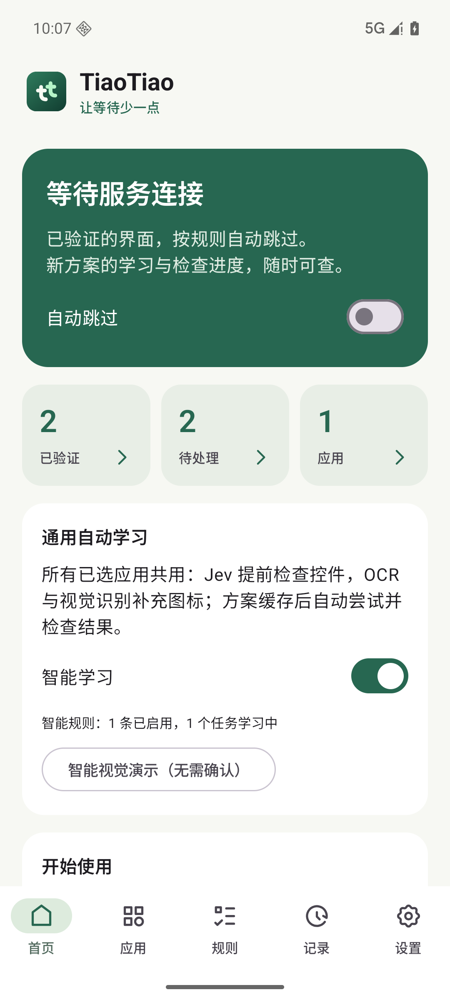
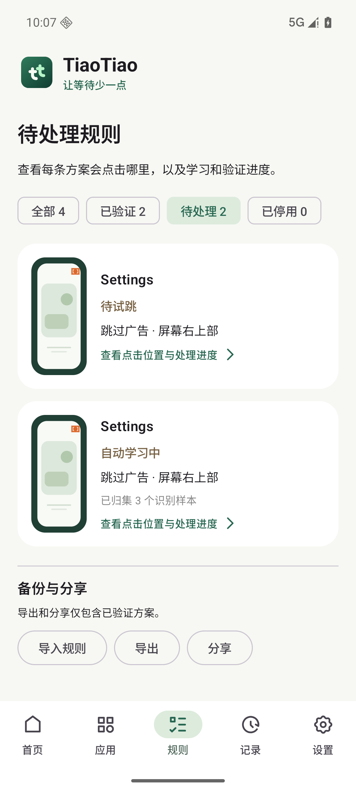
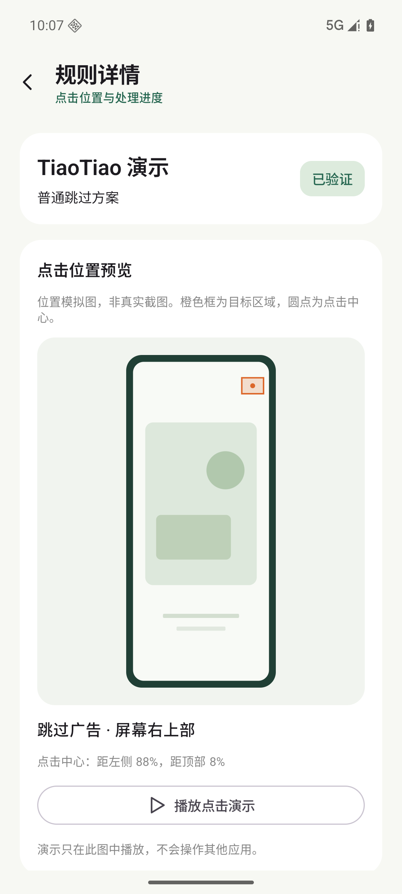

# TiaoTiao

**English** | [简体中文](README.zh-CN.md)

An open-source Android launch-ad skipper with on-device recognition, optional AI learning, and locally verified rules. No root required.

TiaoTiao uses Android's Accessibility Service to find and tap skip or close controls in apps you select. It combines local UI matching and bundled Chinese OCR with optional visual analysis through Jev or DeepSeek. Selected apps share one recognition pipeline rather than app-specific scripts.

Current source version: **0.3.13** · Android **8.0+ / API 26+** · Kotlin + Jetpack Compose · [MIT license](LICENSE)

The app UI is currently in Chinese. Visual learning requires Android 11 / API 30 or later; Android 8–10 use the ordinary rule and manual-confirmation flow. Recognition and touch handling are still being refined, and success varies by app and device. See the [verification log](artifacts/VERIFICATION.md) for the scope of actual tests.

## Features

- **Local rule reuse.** Verified rules match the app package, version, screen structure, and target geometry before acting.
- **Optional AI learning.** Jev and DeepSeek can identify unfamiliar launch ads and review the result of a tap. Visual rules require evidence from separate sessions before automatic verification, or explicit local manual approval.
- **Built-in enhanced touch.** Android 11+ devices can pair through Wireless debugging and start an included system touch service. No separate Shizuku installation is required.
- **Screenshot review.** Inspect real captured samples, zoom in, adjust a tap point, and explicitly approve or disable a proposal.
- **App selection and search.** Enable individual apps, filter by selection or category, and optionally use Jev to classify apps with a persistent local cache.
- **Portable JSON rules.** Import, export, and share verified rules. Imported verification is cleared and must be established on the current device.
- **Manual HTTPS / WebDAV sync.** Upload and download JSON using conditional requests and strong ETags to avoid overwriting changed remote data.
- **Built-in demos.** Exercise ordinary rule confirmation and visual learning with synthetic ad screens.

## Screenshots

These screenshots use synthetic rules or images in an emulator; they illustrate the UI rather than third-party ad recognition accuracy.

| Home | Pending tasks | Rule preview |
| --- | --- | --- |
|  |  |  |

More examples: [screenshot zoom](artifacts/screenshots/0.3.9/ui-ad-screenshot.png) · [tap-point editing](artifacts/screenshots/0.3.9/ui-edit-click-point.png) · [brand assets](artifacts/branding/README.md).

## Getting started

1. [Build the debug APK](#build-and-test), then install `app/build/outputs/apk/debug/app-debug.apk` on your device.
2. Open TiaoTiao and tap **打开无障碍设置** (Open accessibility settings). Enable the TiaoTiao Accessibility Service in Android settings. Depending on Android version and installation source, you may first need to allow restricted settings in the app's system settings page.
3. Turn on **自动跳过** (Auto skip). To check the ordinary rule flow, open **打开模拟开屏** (Open demo launch ad), tap **试跳** (Try skip), and confirm **确实跳过** (Successfully skipped) after the demo home screen appears. Open the demo again to check local reuse.
4. Open **应用** (Apps) and select the apps to handle. All apps are initially disabled. Search and category filters do not change your selection.
5. For cloud learning, configure and test a provider in Settings, then enable **允许云端分析** (Allow cloud analysis) and **通用自动学习** (Universal auto learning). API keys are supplied by you; provider requests may use paid quota.
6. Open a selected app. A late learning result is cached for a later matching launch; an immediate skip on the first launch is not guaranteed.

The Accessibility Service is managed by Android. If it disconnects, check the connection status on the home screen and enable it again through system settings. On Xiaomi / HyperOS, allowing unrestricted battery use and background autostart may be necessary for timely window events.

### Cloud providers

Node analysis and app classification use the Jev connection configured in Settings. Image recognition has a separate provider selector:

| Image provider | Model used by the current code | Configuration |
| --- | --- | --- |
| Jev direct | `jev-latest` | TypeSafe connection and saved Jev key; `https://api.typesafe.ai/v1/systemone` |
| DeepSeek direct | `deepseek-flash` | Separate DeepSeek key; `https://api.deepseek.com/chat/completions` |
| Vercel AI Gateway | `typesafe-ai/jev-1.14.0` | Saved Vercel gateway key; `https://ai-gateway.vercel.sh/v1/chat/completions` |

For Jev direct, select **TypeSafe 直连**, set `jev-latest`, save and test, then select **Jev 官方直连** as the image provider and test images. For DeepSeek, select **DeepSeek 官方直连** and enter its independent official key. DeepSeek image mode bypasses Jev ad-node analysis; app classification can still use the separately configured Jev connection.

The Jev node/classification connection also supports Vercel's TypeSafe-compatible endpoint, `https://ai-gateway.vercel.sh/typesafe/v1/systemone`, with the default model `typesafe-ai/jev`. This is separate from the image endpoint above.

Connection tests use fixed public test input rather than another app's screen; the DeepSeek image test sends a fixed white image. Saving or testing credentials does not enable cloud analysis. Keys are not automatically retried against a different provider, and missing credentials do not trigger a fallback. Clearing one provider's key leaves the other provider's key intact. Never commit API keys or sync credentials.

### Enhanced touch

If a recognized target does not respond to accessibility taps, open **设置 → 增强点击** (Settings → Enhanced touch) on Android 11+:

1. Tap **开始配对** (Start pairing), enable Wireless debugging in Android settings, and open **Pair device with pairing code**.
2. Keep the system pairing dialog visible. TiaoTiao's local assistant reads the displayed code and port, pairs, and starts the included service.
3. If automatic reading is unavailable, use **手动输入** (Manual input) in the overlay on the system page. Enter the code and port with the overlay keypad and tap **配对并启动** (Pair and start).
4. Check that the enhanced-touch card reports a running service. Pairing success alone does not indicate that the service is ready.

Returning to TiaoTiao to enter the code can close Android's pairing dialog. The overlay stays on the system page, avoids the code area, and can be dragged by its title.

The assistant starts only after an explicit action and times out after two minutes. Pairing codes are never persisted or uploaded. The local ADB identity is encrypted separately and excluded from rule exports and sync. After pairing, later sessions normally require only Wireless debugging and **启动增强点击** (Start enhanced touch); a reboot, stopped service, or app update may require starting it again.

The service only accepts coordinate taps for the current foreground app and rechecks the app, screen dimensions, and action freshness. A service callback is not evidence that an ad actually closed. Wireless pairing uses [LibADB Android](third_party/libadb/README.md); touch-channel limitations are recorded in the [touch execution review](docs/TOUCH_EXECUTION_REVIEW.md).

## How learning and verification work

On Android 11+, all selected apps use the same bounded pipeline:

1. A window event starts a detection session. Window ownership, screenshot capture, and background node traversal are handled separately. Node traversal has a 160-node / 150 ms budget and runs off the UI thread.
2. Local UI evidence and bundled OCR look for ad and close controls. The selected cloud image provider can analyze an unfamiliar screen; Jev mode can also choose among currently observed UI nodes. Login, authorization, purchase, download, navigation, and uncertain targets are excluded from execution.
3. Before a tap, a new capture checks the current app, window, scene, and target. A narrowly limited recalibration tap is possible only if the same ad and close control remain unchanged; ordinary node actions do not append coordinate taps.
4. Post-tap frames and an independent visual review check that the ad disappeared and the app reached its home screen. Timing evidence distinguishes an early close from the ad's natural timeout.
5. Automatic verification requires both AI and early-close evidence in two separate sessions. Explicit manual approval enables the current proposal locally without inventing AI successes. Changing a target or relearning clears that approval; imported manual approval is not trusted.
6. Verified rules are reused locally when the context and target match. Uncertain results can require cloud review; when cloud is unavailable and local evidence is insufficient, reuse pauses.

Low-confidence AI results remain candidates and do not count as successes or failures. An unchanged screen is not a successful close even if a model says it is. App-version, target, or action changes invalidate relevant evidence. User-disabled targets stay disabled, and automatic failures use a 15-second, 60-second, then 5-minute relearning backoff.

Real-device testing has observed recognized controls whose taps did not close the ad. Emulator regressions and mocked model responses do not establish real-world success rates. The [DeepSeek evaluation](docs/DEEPSEEK_OFFICIAL_EVALUATION.md), [Jev evaluation](docs/JEV_114_EVALUATION.md), and [verification log](artifacts/VERIFICATION.md) describe these limits.

## Data and privacy

- **Local storage:** ordinary rules live in private `files/rules.json` (schema 1, up to 500 rules / 1 MB); visual rules use `files/visual_rules.json` (schema 2 with schema-1 compatibility, up to 500 rules / 4 MB).
- **Credentials:** API keys and sync credentials are encrypted using Android Keystore. ADB identity is stored separately. None are included in rule exports.
- **Node samples:** text is filtered to permitted recognition terms, such as “广告” (ad) and “跳过” (skip). Input and password subtrees are excluded. Local samples and logs are bounded.
- **Images:** raw captures are processed in memory. Cached and uploaded images mask nonessential OCR text. Masking is not comprehensive personal-data detection. Proposal previews are stored privately under `files/visual_previews/` and removed with their proposal; previews are excluded from export and sync.
- **Cloud requests:** when enabled, node analysis sends filtered UI data and visual learning sends masked images to the configured provider. App classification sends app names and package names to Jev and caches the result locally. Disabling cloud analysis stops new requests.
- **Rule sharing:** exports contain rule data rather than keys, sync credentials, samples, screenshots, or logs. Imported rules are not immediately trusted for execution and must be validated locally. Import does not execute scripts or accept archives.

### HTTPS / WebDAV sync

Set a complete readable and writable JSON-file URL, such as `https://your-host.example/dav/tiaotiao-rules.json`, in Settings. If needed, enter the complete `Authorization` value (`Bearer …` or `Basic …`) in its dedicated field; do not put credentials in the URL.

- The first upload uses `If-None-Match: *` to create a new file. Download and review any existing file first.
- After a download returns a strong ETag, uploads use `If-Match` to prevent overwriting a changed file.
- Uploads contain the complete set of locally verified rules. Imported rules must be validated on the device before being included.
- Existing resources without a usable strong ETag are not overwritten. Plain HTTP and redirects are not supported.

Sync is manual. No TiaoTiao-specific server is required. Continuous background sync, a public rule community, and link-based sharing are not implemented.

## Build and test

Requirements from the current build configuration:

| Component | Version |
| --- | --- |
| JDK | 21 |
| Android SDK platform / compile SDK | 37 |
| Target SDK | 36 |
| Minimum SDK | 26 |
| Gradle Wrapper | 9.7.0 |
| Android Gradle Plugin | 9.3.1 |
| Kotlin plugins | 2.3.21 |

Install Android SDK build-tools and configure `ANDROID_HOME`, or set `sdk.dir` in an untracked `local.properties` file.

```sh
git clone https://github.com/csswork/TiaoTiao.git
cd TiaoTiao
./gradlew :core:test :app:testDebugUnitTest :app:lintDebug :app:assembleDebug
```

The debug APK is written to `app/build/outputs/apk/debug/app-debug.apk`. Test and lint reports are written under each module's `build/reports/`.

### Emulator regression tests

Run instrumentation on an isolated emulator. Tests enable this app's Accessibility Service, change its settings, and replace demo rules. Model responses are mocked; tests do not require real provider keys or operate third-party apps.

```sh
ANDROID_SERIAL=emulator-5580 ./gradlew :app:connectedDebugAndroidTest
```

Use your emulator's actual serial. The `test-app` module builds two fixture apps for broader regression coverage, including deep node trees, icon-only controls, image-only ads, late results, login exclusions, and local reuse. Build and install them explicitly on that emulator:

```sh
./gradlew :test-app:assembleAlphaDebug :test-app:assembleBetaDebug :app:assembleDebug :app:assembleDebugAndroidTest
adb -s emulator-5580 install -r app/build/outputs/apk/debug/app-debug.apk
adb -s emulator-5580 install -r app/build/outputs/apk/androidTest/debug/app-debug-androidTest.apk
adb -s emulator-5580 install -r test-app/build/outputs/apk/alpha/debug/test-app-alpha-debug.apk
adb -s emulator-5580 install -r test-app/build/outputs/apk/beta/debug/test-app-beta-debug.apk
adb -s emulator-5580 shell am instrument -w com.haibo.tiaotiao.test/androidx.test.runner.AndroidJUnitRunner
```

The fixture regression includes emulator guards and must not run on a real phone. When a phone is also connected, always select the emulator explicitly.

## Project layout

```text
app/          Android UI, Accessibility Service, private storage, provider clients, sync
core/         Rule models, matching, verification state machines, JSON and AI protocols
test-app/     Emulator-only fixture apps
docs/         Design notes, evaluations, and implementation reviews
third_party/  Retained upstream assets, provenance, licenses, and notices
tools/        Branding and icon conversion scripts
artifacts/    Screenshots, verification records, and local build artifacts
```

Further documentation (mostly in Chinese): [detailed Chinese guide](README.zh-CN.md) · [design and roadmap](docs/AI_DATA_PLAN.md) · [flow review](docs/FLOW_REVIEW.md) · [recognition options](docs/RECOGNITION_OPTIONS.md) · [performance notes](docs/PERFORMANCE.md).

## Contributing

Bug reports and focused pull requests are welcome. For recognition or touch issues, include the TiaoTiao version, Android version, device model, target app version, reproduction steps, and redacted diagnostics. Remove keys, credentials, and personal screen content before sharing. Separate emulator or mocked-response results from real-device observations.

## License

TiaoTiao's original code and documentation are licensed under the [MIT License](LICENSE), copyright © 2026 Haibo.

Third-party code, icons, dependencies, and SDKs retain their respective licenses and terms. In particular, the included QingIcon subset and the selected LibADB Android license are Apache-2.0. See [third-party notices](THIRD_PARTY_NOTICES.md) for retained license files and provenance.
